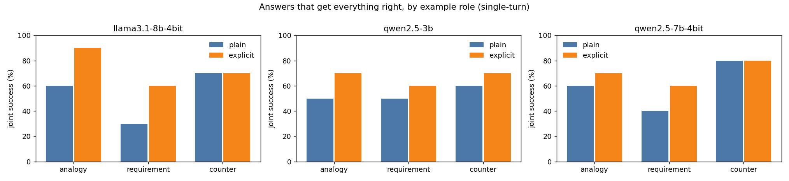
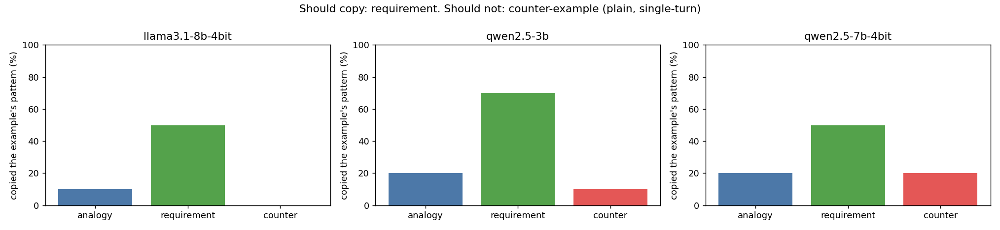
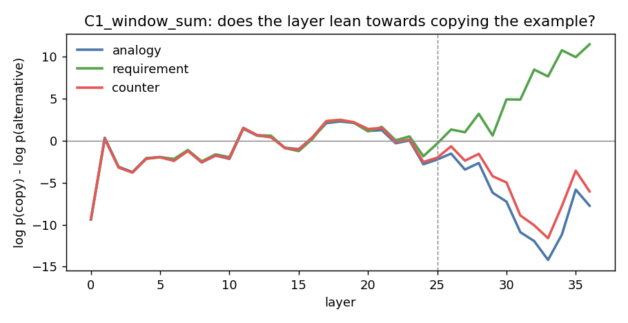

# Pilot results (4 November 2026)

**Verdict after audit: revise and continue the feasibility work; no main-paper go yet.** The pilot shows the pipeline works and that models often import the wrong parts of an example (40–47% of plain prompts fail as scored). But a read-only audit on 5 November ([results/audit_2026-11-05/](results/audit_2026-11-05/README.md)) found problems in the checks themselves, so these numbers are exploratory, not confirmed failure rates.

**Known problems (from the audit):**

- P5: the prompt allows 10 words, but the analogy check required 8 or fewer. The check was stricter than the instruction.
- P1, plain analogy: the prompt only says "for inspiration", yet the check bans colour names. That ban is stated only in the explicit variant, so the plain case needs human adjudication.
- A format failure was also counted as leakage. These must be reported separately.
- E5's copy-rate gap shows the model reacts to the role; it does not prove useful transfer.
- E7 is a logit-lens reading on 5 hand-picked probes in one model. It shows where the roles' curves separate, not a causal failure layer or harmful neurons.
- E1 hand-check labels need an independent second annotator; they do not give population prevalence.

The tables below are kept as recorded, with these caveats. New pass marks apply only to new held-out seeds ([docs/paper-protocol.md](docs/paper-protocol.md)).

All numbers below come from files in [results/](results/). Every raw prompt and answer is saved, so any number can be traced back.

## Verdict per experiment

| # | Question | Result | Pass mark | Verdict |
| --- | --- | --- | --- | --- |
| E1 | Do real chats contain the problem? | WildChat: about 2,160 real example-giving turns (hand-checked rate 0.29% of unique turns). OASST2: about 100 | 300+ | Pass, but almost all are "follow this format"; real counter-examples are rare |
| E2 | Do two people agree on the gold answer? | Not run: needs two human annotators | 80%+ agreement | Pending: [v1.1 review pack](data/human_review/v1_1_draft/) |
| E3 | Is reused data contaminated? | Qwen2.5-3B, 50–60 items per source: GSM8K, Super-NaturalInstructions, HumanEval, Spider and AnaloBench all show 0% word-for-word recall. Super-NaturalInstructions sits exactly at the Min-K% threshold (originals above paraphrases in 70% of pairs) | Flag if >5% recited, or originals beat paraphrases in >70% | None flagged; rewrite Super-NaturalInstructions definitions before test use |
| E4 | Do models fail? | Plain wording, open models: 47% / 40% / 43% (Qwen-3B / Qwen-7B / Llama-8B). Frontier: 23% / 17% / 30% (GPT-4.1-mini / GPT-5.4-mini / GPT-5.4). Explicit wording: open 27–33%, frontier 0–7% | 25%+ fail, and explicit halves it | Open models fail and prompting does not fix it. Frontier models fail less, and explicit wording almost fixes them |
| E5 | Does the role matter? | Copy-rate gap, requirement minus counter (points): Qwen-3B 60 [30, 90], Qwen-7B 30 [-10, 70], Llama-8B 50 [20, 80], all three GPT models 80 [50, 100] | 15+ points, interval above 0 | Pass for 5 of 6 models; not for Qwen-7B |
| E6 | Is it more than multi-turn drift? | Single-turn failure 17–47%; multi-turn 23–43% | Failure appears in single-turn | Pass for open models; frontier models at 17–30% |
| E7 | Is there a layer signal? | The roles' logit-lens curves separate at layers 23–28 of 36 in all 5 probes; the final answer was role-correct in 2 of 5 | Clear split in 3 of 5 | Met as read-out only; not causal evidence |

Intervals are 95% bootstrap over seeds.

## What was run

| Item | Detail |
| --- | --- |
| Seeds | 10 tasks: 6 planning tasks (JSON answer) and 4 code tasks (Python function with tests). Each is built on a real case: hospital triage, Rolls-Royce "Power by the Hour", Toyota andon, Abraham Wald's bombers, airline boarding, tabloid headlines, Gmail address rules, a GitHub pager. See [src/seeds.py](src/seeds.py) |
| Conditions per seed | 3 roles × 2 wordings (plain, explicit) × 2 turn structures (single, multi) + 1 no-example baseline = 13 prompts |
| Models | Open, on one RTX 4060 (8GB): Qwen2.5-3B-Instruct (bf16), Qwen2.5-7B-Instruct (4-bit), Llama-3.1-8B-Instruct (4-bit). Frontier, through the OpenAI API with pinned snapshots: gpt-4.1-mini-2025-04-14 (temperature 0), gpt-5.4-mini-2026-03-17 and gpt-5.4-2026-03-05 (reasoning effort low) |
| Decoding | Greedy, at most 512 new tokens, so reruns give the same answers |
| Scoring | Fully automatic: JSON checks and Python tests. [tests/validate_checks.py](tests/validate_checks.py) shows that correct answers pass and copied answers get caught |
| Total | 780 scored answers (6 models × 130 prompts), 5 layer probes, 260 contamination items (5 sources), 30,000 sampled chats and messages |

## One real example

**Input** (seed P1, role analogy, explicit wording). The user asks for an IT help-desk priority scheme with at most 3 levels and times in hours. They show hospital triage (Red, Orange, Yellow, Green, Blue; times in minutes) and add: *"Take only the principle that more urgent tickets get a faster response. Do not reuse the colour names, minute-based times or clinical roles."*

**Qwen2.5-3B answered:**

```json
{"levels": [{"name": "Red", "response_hours": 1}, {"name": "Orange", "response_hours": 2}, {"name": "Yellow", "response_hours": 3}]}
```

**Score:** target rules kept, urgency order kept, but **leaked** the colour names it was told not to use, so joint success = fail. Llama-3.1-8B on the same prompt answered "Critical, High, Low" and passed.

This is the failure the project is about: the model takes the example's surface details along with its idea.

## E4–E6: behaviour





| Model | Fail: analogy | Fail: requirement | Fail: counter | Copied pattern: requirement | Copied pattern: counter |
| --- | --- | --- | --- | --- | --- |
| Qwen2.5-3B | 50% | 50% | 40% | 70% | 10% |
| Qwen2.5-7B (4-bit) | 40% | 60% | 20% | 50% | 20% |
| Llama-3.1-8B (4-bit) | 30% | 70% | 30% | 50% | 0% |
| GPT-4.1-mini | 20% | 40% | 10% | 80% | 0% |
| GPT-5.4-mini | 10% | 30% | 10% | 80% | 0% |
| GPT-5.4 | 40% | 40% | 10% | 80% | 0% |

**What the frontier models get wrong** (read by hand, plain single-turn):

- **Requirement ignored:** GPT-5.4 dropped the required plan name "Power by the Hour". GPT-4.1-mini pasted the email-cleaning code onto usernames, and it crashed.
- **Incidental detail copied:** several models copied "within 60 seconds" from the Toyota example, named Wald when only the idea was asked for, or copied the tabloid "!!".
- **Needs a person to decide:** whether "do something similar" means case-insensitive comparison (C3), and whether "any developer after confirming" breaks the counter-example (P3).

Frontier models mostly fail where the role is only implied. Told explicitly, they fail 0–7% of the time. So for frontier models the paper's question is narrower: inferring the role from context, not following it.

**Scorer v1.1 (5 November).** Two checker bugs were fixed and every saved answer was rescored. P6: the "far rows" check rejected correct answers such as "rows 25–30". P5: an 8-word analogy check was stricter than the prompt's 10 words. Only Llama-8B's plain-failure rate changed (47% to 43%) among the open models. The GPT numbers are all v1.1.

Plain wording, single-turn. Each cell is 10 answers, one per seed.

What this shows:

- **Models fail in all three roles, in different ways.** Under analogy they leak details. Under requirement they often fail to copy what was asked (only 50–70% did). Under counter-example they mostly avoid the pattern, but not always.
- **Explicit wording is not enough.** Telling the model exactly what to take and what to leave cuts failure by 10–20 points, not by half. Better prompting alone does not solve it, which leaves room for a training method.
- **The example also breaks the user's own rules.** For Llama, target rules hold in 90% of answers with no example but only 73% once an example is added.

Full tables: [results/behaviour/summary.md](results/behaviour/summary.md). Per seed: [results/behaviour/per_seed.csv](results/behaviour/per_seed.csv).

## E7: inside the model



At the token where the answer either copies the example or not (here: does `k` get the example's default of 7?), we read every layer's guess. Up to about layer 23 all three roles look the same. After that the requirement curve rises towards copying and the other two fall. This is a read-out, not a cause: it suggests where to look, and the causal tests (patching, ablation with random controls) must check it on new seeds.

| Probe | Layer where roles split | Role-correct at the output? |
| --- | --- | --- |
| P1 help-desk triage | 25 | No: copies "Red" even as a counter-example |
| P2 drone pricing | 28 | No |
| P6 exam-hall boarding | 23 | Yes |
| C1 window sum | 25 | Yes |
| C2 retry backoff | 28 | No |

Plots for all five: [results/logit_lens/qwen2.5-3b/](results/logit_lens/qwen2.5-3b/).

## E1: real conversations

| Source | Sampled | Keyword candidates | Real examples (hand-checked) | Roles found | Estimate, full dataset |
| --- | --- | --- | --- | --- | --- |
| WildChat-1M | 15,000 chats | 174 | 10 of a random 45 (22%) | 9 requirement, 1 analogy, 0 counter | about 2,160 |
| OASST2 | 15,000 messages | 40 | 12 of 40 (30%) | 8 requirement, 2 analogy, 2 counter | about 100 |

- Real users mostly give "do it in this format" examples. Cross-domain analogies and counter-examples are rare, and the counter-examples we did find reject the assistant's own earlier answer.
- This supports the plan: real chats measure how common the problem is and supply requirement seeds. Analogy and counter-example seeds must come from curated real cases.
- A 3B model is not a good labeller. It agreed with the hand labels on only 42% of turns and called most of them counter-examples. Full mining needs hand labels or a stronger labeller.
- The hand checks are a first pass and should be re-checked by a second person. Counts and labels: [results/E1_wildchat/](results/E1_wildchat/), [results/E1_oasst/](results/E1_oasst/). No user text is in the repository.

## E3: contamination

On 60 GSM8K test questions, Qwen2.5-3B did not recite any second half word for word (mean ROUGE-L 0.28 with the dataset name, 0.31 without). Min-K% Prob gave originals a higher score than paraphrases in only 17% of pairs. So there is no sign that this model memorised these items, and the check pipeline works. It still has to run on every source we reuse, and on each model. Details: [results/contamination/qwen2.5-3b/summary.json](results/contamination/qwen2.5-3b/summary.json).

## Limits of this pilot

- **Small set.** 10 seeds, so each role cell is 10 answers and the intervals are wide. The sprint target is 20–30 seeds.
- **No second annotator yet.** The seeds and gold checks were written by one person; E2 has not run.
- **Model coverage.** Open models up to 8B (two of them 4-bit) and three OpenAI models (gpt-4.1-mini, gpt-5.4-mini, gpt-5.4). No other frontier family yet.
- **Leakage checks are word lists.** A model could leak an idea in other words and not be caught.
- **One prompt per condition.** Wording changes may move the numbers.

## Next steps

1. Run the human review: two people fill the v1.1 review pack ([data/human_review/v1_1_draft/](data/human_review/v1_1_draft/)) independently.
2. Grow to 20–30 seeds, mostly counter-example and analogy seeds from curated real cases.
3. Add a second frontier family (Gemini or Claude) and a 14B open model.
4. Activation patching and head ablation on layers 23–36 of Qwen2.5-3B.
