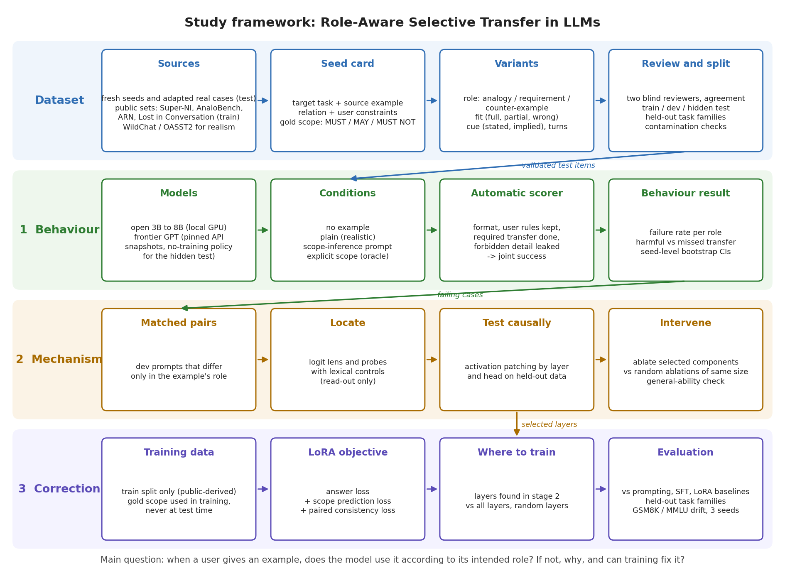

# Role-Aware Selective Transfer in LLMs: Detailed Proposal

7 November 2026 · Md. Tanzamul Azad (0112230863), United International University

**Working title:** "That Was Just an Example": Learning Role-Aware Selective Transfer in LLMs. **Area:** NLP, instruction following, transfer from user examples, mechanistic interpretability. **Target:** ACL or EMNLP main track. Submission timing follows validated results.

This is the full version for the team and anyone who wants the details. The short version for the supervisor is the 3-page formal proposal. This document covers the framework, how the benchmark and dataset are built, how training data is made and the model is trained, how everything is evaluated, and the complete literature review (Appendix A).

*Figure 1. The study in four lanes. The dataset feeds validated items to the behaviour study. Its failing cases go to the mechanism study, and the layers it finds tell the training method where to train.*

## Summary

When a user gives an LLM an example, the example has a role. It may show an idea to borrow (analogy), a part to follow exactly (requirement), or a pattern to avoid (counter-example). A good answer takes only what the role allows and keeps the user's own rules. We build a benchmark that tests this, find where inside the model it goes wrong, and train the model to fix it.

A pilot on 10 seeds and 6 models suggests the problem is real: on plain prompts, open models fail 40–47% of the time and frontier GPT models 17–30%. The pilot seeds were not human-validated, so these numbers only justify building the real benchmark. If the training method does not beat the baselines, the benchmark and the analysis still stand as a paper.

## 1. Problem and research question

A user asks for a ticket-priority scheme for a university IT help desk, with at most three levels, and cites hospital triage. The principle "urgent cases first" should transfer; the hospital's colour codes and minute-based times should not. If the user instead says the faculty already uses those colour codes, the colour names become required. The same example calls for different answers depending on its role, and the right answer is fixed by the prompt, not by the example alone.

**Main research question.** When a user gives an example, do large language models use it according to the role the user intends, and if not, why do they fail and can training correct it?

1. **Behaviour.** When only the role of an example changes, do models change what they transfer accordingly, while keeping the user's own constraints?
2. **Mechanism.** Which internal components carry the example's role and drive the transfer of source details?
3. **Correction.** Does training that supervises transfer scope improve role-correct transfer on unseen tasks, beyond prompting and standard fine-tuning?

**Why not simply ask explicitly?** Telling the model exactly what to take works as an oracle: the user makes the very judgement the model is meant to make. Real users rarely do this. In our WildChat and OASST2 samples, people give the example and leave the role implied, and under that condition frontier models still fail 17–30% of the time. Open models fail 27–33% even when told explicitly. Agents that reuse retrieved documents or earlier code face the same problem with no one to state the scope.

## 2. Related work and novelty

We read ten close papers in full, including method sections and appendices, plus four layer-level papers. The full notes, comparison table and dataset survey are in Appendix A. In short:

| Work | What it studies | What it leaves open |
| --- | --- | --- |
| [Copy bias in ICL](https://aclanthology.org/2026.findings-eacl.13/) (Findings of EACL 2026) | Models copy labels from demonstrations; pruning a few MLP neurons reduces it | Copying is always wrong there; it never tests when copying is required |
| [Overthinking the Truth](https://arxiv.org/abs/2307.09476) (ICLR 2024) | Late layers overwrite correct answers with copied false demonstrations; ablating 5 heads helps | Demonstrations are false labels, not user examples with a role |
| [Do as I Say, Not as I Do](https://arxiv.org/abs/2605.20382) (COLM 2026 workshop) | Instructions lose to in-context pattern pressure | Examples are always to be resisted |
| [AnaloBench](https://aclanthology.org/2024.emnlp-main.725/) (EMNLP 2024), [ARN](https://arxiv.org/abs/2310.00996) | Finding analogies between stories, against look-alike distractors | Identifying an analogy, not using one on a task under constraints |
| [LLMs Get Lost in Multi-Turn Conversation](https://arxiv.org/abs/2505.06120) (2025) | Performance loss when instructions arrive over turns | The example's role is not a variable |
| [ReTRE](https://aclanthology.org/2026.acl-long.2048/) (ACL 2026) | Robustness to rewrites; SFT overfits, RL holds up | Transfer from the model's own knowledge, not from a user's example |

**Proposed novelty.** A benchmark in which the same example appears in different roles, with a prompt-grounded gold scope (must use, may use, must not use). A causal comparison of harmful and useful transfer inside the model. A training objective that supervises transfer scope. Neuron pruning alone is not claimed as new.

## 3. Pilot, in brief

The pilot (4–6 November) checked that the effect exists and the pipeline runs: 10 hand-written seeds, 130 prompts per model, 6 models, scored automatically.

| Model | Failure, plain wording | Failure, explicit wording |
| --- | --- | --- |
| Qwen2.5-3B | 47% | 33% |
| Qwen2.5-7B (4-bit) | 40% | 30% |
| Llama-3.1-8B (4-bit) | 43% | 27% |
| GPT-4.1-mini | 23% | 7% |
| GPT-5.4-mini | 17% | 0% |
| GPT-5.4 | 30% | 3% |

Explicit wording fixes frontier models but not open ones. A logit-lens read-out of Qwen2.5-3B shows the roles separating around layers 23–28 of 36, which tells the mechanism study where to look. Real conversations contain example-giving turns, mostly "follow this format". No public source we plan to reuse was flagged by contamination diagnostics. An audit found four checker errors, all fixed before rescoring. The pilot announced roles fairly directly, used short contexts and had no target-fit axis; the benchmark design below fixes each of these. Pilot data is development evidence only and never test data. Every answer, score and notebook is in the repository and the Drive folder (Section 10).

## 4. Benchmark and dataset construction

### 4.1 The unit: a seed

A **seed** is one target task, one source example, the relation that may transfer, the user's constraints and a gold scope. Role changes, paraphrases and detail substitutions are **variants** of that seed. Variants are never counted as independent items and never split across train and test.

**Worked example (one seed, three roles).** This is a newly written construction example, not a validated item.

- **Target.** Design exactly three university IT response tiers, ordered most to least urgent, as JSON with tier names, response hours and assignments for exam system, Wi-Fi and printing. Times are whole hours, strictly increasing, at most 72. Two existing staff; no extra staffing.
- **Source.** A fictional equipment depot handles complete shutdowns first, degraded service next, cosmetic faults last. Its tiers are Cobalt (5 minutes), Amber (30 minutes) and Pearl (120 minutes), staffed by six inspectors.

| Role | What the user says | Gold scope |
| --- | --- | --- |
| Analogy | Apply the severity-ordering idea; choose our own tier names and hours | Exam system before Wi-Fi before printing; keep the hour and staff limits; do not carry over the depot's names, minute units or inspectors |
| Requirement | Use exactly Cobalt, Amber, Pearl as tier names, in that order | Copying the names is correct; copying the minute deadlines or the staffing is not |
| Counter-example | Avoid the depot's colour labels, which confused our students | Avoid the labels; keep the useful ordering; do not assume everything in a negative example is forbidden |

Two controlled changes check that the model reacts for the right reason. An **incidental-detail** change (six inspectors become nine) must leave every answer unchanged. A **misleading-fit** version (the depot orders by cosmetic appearance, but the university's rule is service disruption) must make the model follow the university's rule, not the example.

### 4.2 Variation axes

| Axis | Values | What it tests |
| --- | --- | --- |
| Role | analogy, requirement, counter-example | The main variable |
| Cue | stated, implied (at least half of all variants) | Whether the model can infer the role when the user does not announce it |
| Target fit | full, partial, wrong | Whether the model notices when an example only partly applies or does not apply |
| Turns | single, information-equivalent multi-turn | Whether conversation structure changes the result |
| Length | standard, long source examples | Whether longer contexts raise failures |
| Incidental-detail control | detail swapped, role kept | Whether answers change for reasons they should not |

We build only combinations that make sense. Each skipped cell is recorded as not applicable, with a reason. Difficulty, length and coverage are calibrated against what humans can still infer; we never make an item hard by leaving out information or adding contradictions.

### 4.3 Gold scope and automatic checks

Every variant lists what the answer must use, may use and must not use, plus the user's own rules. Each item carries the prompt evidence behind it.

| Field | Meaning |
| --- | --- |
| MUST USE | Relation or detail the answer is required to use |
| MAY USE | Allowed but optional; using it is not a failure |
| MUST NOT USE | Use breaks an explicit prohibition or a target constraint |
| Target constraints | Rules of the user's own task |
| Evidence | The prompt text behind each item, marked DIRECT (stated) or INFERRED (implied by the role) |

Every MUST, MUST NOT and target rule has an automatic check. Decision tasks are checked on their JSON answer (counts, ranges, orderings, allowed and banned words). Code tasks are checked with unit tests. Each check records its **basis**: stated in the prompt (with the exact quote), a target rule, or implied by the role. An implied check marked ambiguous cannot be scored until a person adjudicates it. This rule exists because the pilot had a check stricter than its prompt.

Before any model is scored, every seed must satisfy:

- a reference answer for each variant passes all its checks, including the incidental-detail control;
- a deliberately copied answer for each variant fails a transfer or leakage check;
- any alternative valid answer passes, which guards against checks that are too strict;
- leak terms appear only in the source, never in the target or the user's own words.

The seed format (`docs/seed-spec-v1.md`) and its linter (`src/seed_lint_v1.py`) enforce these rules automatically. Ten draft cards (68 variants) are written and waiting for review.

### 4.4 Sources and what we take from each

| Source | What we take | What we do not assume | Use |
| --- | --- | --- | --- |
| Newly written scenarios | New source-target combinations with explicit gold scope | That fresh text means the underlying idea is unseen | Main pool for the test set |
| Documented real cases | Cases where an example misled people (e.g. Kodak treating digital like film), with provenance | That a paper licence covers its data | Realistic test seeds |
| WildChat-1M, OASST2 | Real requests where a user supplies an example, with enough context | That every "for example" is relevant, or that the public answer is gold | Realism guide and a separately analysed natural slice; text paraphrased, never released |
| Super-NaturalInstructions | Task definitions with human-written positive and negative examples and the reason for each | That a negative task example is a natural user counter-example | Training pool; definitions rewritten before any test use |
| AnaloBench, ParallelPARC, ARN | Relational mappings and look-alike distractors | That analogical similarity gives a ready target solution | Training pool, after licence and usefulness checks |
| Lost in Conversation | Checkable target tasks (code, SQL, maths) | That they contain examples with roles | Target tasks, so scoring stays automatic |

Test and training data come from different sources, so a good test score cannot come from memorised training items. No single source supplies more than 40% of the seeds, and each task family needs at least 40 seeds.

**Inclusion test for real conversations.** A candidate needs (1) a target request, (2) a concrete example the user actually supplied, (3) a recoverable connection between them, and (4) enough context to annotate role and scope. We exclude text given only for translation or summary, prose that happens to say "for example", and requested examples the user never supplied. We sample keyword hits and a random set of misses, record IDs, revisions and sampling seeds, and report the filter's precision. Candidate-sample fractions are not extrapolated to corpus counts.

### 4.5 Construction pipeline

1. Register each candidate's source, ID, revision, licence and annotation provenance.
2. Extract task, constraints, example and relation into a seed card.
3. Check that solving the target actually needs the source relation; record a no-example control.
4. Write the three role variants (fewer if a role would be unnatural).
5. Annotate MUST / MAY / MUST NOT per variant; mark fit only where it is meaningful.
6. Add an incidental-detail pair and, where valid, a structural pair, changing one factor at a time; recompute gold after every change.
7. Two people review the card blind and independently; disagreements are adjudicated. AI labels stay labelled as AI.
8. Challenge the checks with valid alternatives and wrong answers.
9. Group by seed, conversation, original item, source story and template; whole groups go to one split.
10. Write a versioned manifest with file hashes and split assignments; lock the test split before any model is run on it.

### 4.6 Human review and agreement

Two annotators review each seed blind and independently. An author never reviews their own seed. Each reviewer gets only their own pack, with prompts in a different order, and submits part 1 (role, scope, realism) before seeing part 2 (the flagged ambiguous checks). Reviewers never see model outputs or the researcher-only manifest.

We report agreement before adjudication: Cohen's kappa on role labels, and agreement on predefined atomic scope items for MUST / MAY / MUST NOT (free-text answers are first aligned to these items). Target: kappa of at least 0.6 overall. Both reviewers rate realism from 1 to 5, and we keep seeds rated 4 or above by both. Rejected and ambiguous items are reported, not hidden.

### 4.7 Collection plan and size

| Phase | When | Target |
| --- | --- | --- |
| Validation | to 12 November | 20–30 reviewed development seeds: the 10 draft cards after repair plus 10–20 new ones |
| Benchmark | after a go | Batches of 20 up to 120–200 accepted seeds across 2–3 domains, about 4–6 variants each |
| Training pool | only if training goes ahead | 200–500 seed groups, with learning curves at several sizes |

Each contributor first submits 10 candidate seeds with source, excerpt or original-authoring statement, task, relation, constraints and scope evidence. That batch is timed before larger assignments. We record drafting, review and adjudication time and the acceptance rate a; for N accepted seeds we plan about N/a candidates. Distinct relations and domains matter more than name-and-number substitutions. The benchmark starts in English; a Bangla subset would be a separately validated study.

### 4.8 Splits, contamination and exposure

| Question | Control | What we can claim |
| --- | --- | --- |
| Did our own training or development see the test family? | Provenance-group splits, duplicate and near-duplicate audit, no test-driven selection, locked manifests | Our exposure policy and the overlap we measured |
| Could the pretrained model have seen a public source? | Fresh constructions, counterfactual pairs, guided-completion and Min-K% Prob diagnostics on every reused source | An exposure risk estimate, not proof of clean data |
| Will running the test leak it? | Local open models where possible; APIs only on paid plans with a no-training data policy; access log; hidden test never in the public repository | A managed disclosure history |

Whole task families or relations are held out to test generalisation. Rewriting names and numbers does not remove structural familiarity, and a clean diagnostic is not a certificate ([Sun et al., ICML 2025](https://proceedings.mlr.press/v267/sun25t.html)).

## 5. Training data and training method

### 5.1 How the training data is built

The training pool is built only from training-side sources (Section 4.4), converted to the same seed format and passed through the same pipeline, so every training item has a gold scope. Within the training split we augment by changing role, cue, fit and incidental details, one factor at a time. If an AI model drafts training items, it sees only training material, never held-out items, and its drafts are labelled. Many variants of a few templates are not diverse training data, so we report learning curves at several pool sizes and count distinct relations, not variants.

Each training example has:

- **input:** the user's prompt (task, rules, example, role cue), exactly as at test time, with no gold scope;
- **targets:** a valid answer, and the gold scope (what to take, what may be taken, what to leave);
- **pair links:** its sibling variants of the same seed, marked "should change the answer" (role or scope changed) or "should not" (only an incidental detail changed).

### 5.2 Objective

We fine-tune with LoRA (QLoRA for memory) using three terms:

1. **Task loss:** produce a valid answer for the target task.
2. **Scope loss:** predict the transfer scope, so the model learns to decide what to take, leave and keep.
3. **Paired consistency loss:** across sibling variants, the answer's gold-defined properties stay the same when only an incidental detail changes and change when the role changes. Consistency is measured on answer properties, not wording.

Gold scope is used only in training; at test time the model must infer the scope from the prompt. If the mechanism study locates the role in specific layers, the same objective is also trained only in those layers. The exact form of the scope and consistency terms and their weights are tuned on development data and fixed at protocol freeze.

### 5.3 Training setup

3–4B models are trained locally with QLoRA; one 7–8B run confirms the main result on rented GPU time. Every trained method gets the same data, the same number of trainable parameters and the same tuning budget. Each result is averaged over 3 random seeds.

### 5.4 Baselines

| Comparison | Purpose |
| --- | --- |
| No example | Shows whether a failure comes from the example or from the task itself |
| Plain prompt | The realistic condition: the role is stated or implied as a user would |
| Scope-inference prompt | A strong prompting baseline: the model is asked to work out what to take before answering |
| Explicit scope (oracle) | Upper bound: the gold scope is given; reported as a diagnostic, not as a competitor |
| Supervised fine-tuning | Standard training on the same data without scope supervision |
| LoRA on all or random layers | Tests whether choosing layers from the mechanism study matters (equal parameter count) |
| Last-layer retraining | Tests whether fixing only the final layers is enough |
| Random ablation | Control for the mechanism study: removing as many random components |

DPO or GRPO are added only if the claim needs them and compute allows. ReTRE found that RL generalises better than SFT on transfer, so GRPO is the first candidate.

## 6. Mechanism study

We make no prior claim about where the mechanism sits; it may be early, middle, late or distributed. Components are selected on development data only and locked before any test evaluation.

1. **Locate (dev).** Logit lens and probes with lexical controls on matched pairs that differ only in role.
2. **Test causally (held-out).** Activation patching by layer and by head on token-aligned pairs, checking how sensitive the result is to the patching metric ([Zhang and Nanda, ICLR 2024](https://proceedings.iclr.cc/paper_files/paper/2024/hash/06a52a54c8ee03cd86771136bc91eb1f-Abstract-Conference.html)).
3. **Intervene.** Ablate the selected heads or neurons and measure harmful transfer, useful transfer and joint success together. Removing useful transfer along with the harmful kind counts as a failure.
4. **Controls.** Random ablations of the same size, random components within the same layers, and a general-ability check.

Models: Qwen2.5-3B in bf16, a second 3–4B model from another family, and one 7–8B confirmation run. Internal analysis needs full-precision weights, because 4-bit quantisation distorts activations.

## 7. Evaluation

### 7.1 Metrics

| Metric | Definition |
| --- | --- |
| **Joint success** (primary) | The answer is well formed, keeps every target rule, does everything in MUST USE, and uses nothing in MUST NOT USE |
| Harmful transfer | Share of answers that use a MUST NOT item |
| Missed transfer | Share of answers that fail a MUST item |
| Constraint retention | Share of answers that keep all of the user's own rules; compared with the no-example control |
| Role sensitivity | How much the answer changes between roles of the same seed, measured on gold-defined properties |
| Consistency | How often the answer stays the same under an incidental-detail change |
| Format failure | Reported separately; never counted as leakage |

Using a MAY USE item is never a failure. A large requirement-versus-counter-example copying gap is a sanity check that models react to the role, not evidence of failure.

### 7.2 Conditions and models

Each test seed runs under no example, plain prompt, scope-inference prompt and explicit oracle. Models: open models of 3–8B run locally (greedy decoding, saved outputs), and frontier models through pinned API snapshots (Section 4.8 covers data handling). Every output, prompt and scorer version is saved, so any result can be rescored and traced.

### 7.3 Statistics and generalisation

- Seed-level bootstrap intervals and paired tests, because variants of one seed are correlated.
- Primary comparisons, test families, metrics and the correction method are fixed at protocol freeze; any later change is logged as a dated deviation.
- Generalisation is measured on held-out task families and held-out relations, not only held-out stories.
- General ability (for example GSM8K and MMLU) is checked after every intervention and training run.
- A small natural or human-authored slice is analysed separately, to test whether findings hold beyond constructed items. Real-world prevalence is never inferred from balanced constructed data.

## 8. Timeline and compute

**Validation week (7–12 November):** blind review of the v1.1 pack, then the seed work in Section 4.7; one local and one frontier model on the validated prompts under all four conditions; a dev-only patching prototype; supervisor decision on 12 November.

**Go requires all four:** (1) annotators agree on role and scope well enough, at a sustainable workload; (2) a reproducible failure remains on validated prompts after practical prompting, not explained by task inability or checker error; (3) a clear difference from the closest prior work; (4) the intervention and training pipeline runs within our resources. Incomplete evidence means revise, not go.

| Period | Work |
| --- | --- |
| Nov 2026 – Jan 2027 | Benchmark to 120–200 seeds; full behaviour study |
| Feb – Mar 2027 | Mechanism study; training method against baselines |
| Apr – May 2027 | Held-out evaluation, ablations, writing; submission to the next suitable ARR cycle (EMNLP 2027 is the realistic target) |

**Compute.** Local RTX 4060 (8 GB) and RTX 5070 Ti (16 GB) cover 3–4B mechanism work and QLoRA training. Final 7–8B runs need about 150–300 A100-hours. API cost so far is under one US dollar; we propose a cap of USD 10 for the validation week.

## 9. Risks and decisions requested

| Risk | Response |
| --- | --- |
| Annotators cannot agree on scope | Redesign seeds and rules; report as revise, not go |
| Frontier models no longer fail once prompts are validated | Focus on inferred roles, longer contexts and open models; the paper becomes a benchmark and analysis contribution if training adds nothing |
| Overlap with copy-bias or instruction-conflict work | Centre the claim on role-dependent use, where copying is sometimes required |
| No clear causal mechanism | Report behaviour and training results; describe mechanism findings as exploratory |
| Collection is slower than planned | Size targets follow measured acceptance rate and time per seed |
| Test items leak into future training data | Hidden test kept out of the public repository and run only through no-training APIs |

**Decisions requested from the supervisor**

- [ ] Approval of the validation week and its go / revise / stop criteria
- [ ] The two task families, and the source and authoring policy
- [ ] Reviewer arrangement: who reviews the seeds written by whom
- [ ] Whether to add a Bangla subset now or as a later study
- [ ] Compute support for the 7–8B runs, and the API budget
- [ ] Scope of the training contribution and its baselines

## 10. Where everything is

| What | Where |
| --- | --- |
| Code, seed format, seeds, prompts, every saved answer and score | [GitHub: Tanjamul-Azad/ContextLLM](https://github.com/Tanjamul-Azad/ContextLLM) |
| Browsable copy: proposal, dataset, results, Colab notebooks | [Google Drive: DL paper](https://drive.google.com/drive/folders/1PDY9RPmH4ioq-y9gHqcQZVryrqk3Xnwm) |
| Pilot inputs and all model answers as a spreadsheet | Drive 03_Results: "Pilot data - inputs and every model answer" |
| Results notebooks with outputs, and notebooks to re-run each experiment | `notebooks/results/` and `notebooks/`, linked from Drive |
| Raw WildChat and OASST2 user text, API keys | Local machine only; never uploaded |

## References

- Ali, Wolf and Titov. [Mitigating Copy Bias in In-Context Learning through Neuron Pruning](https://aclanthology.org/2026.findings-eacl.13/). Findings of EACL 2026.
- Halawi, Denain and Steinhardt. [Overthinking the Truth: Understanding how Language Models Process False Demonstrations](https://arxiv.org/abs/2307.09476). ICLR 2024.
- Camassa and Shiller. [Do as I Say, Not as I Do: Instruction-Induction Conflict in LLMs](https://arxiv.org/abs/2605.20382). COLM 2026 workshop.
- Ye et al. [AnaloBench](https://aclanthology.org/2024.emnlp-main.725/). EMNLP 2024.
- Sourati et al. [ARN: Analogical Reasoning on Narratives](https://arxiv.org/abs/2310.00996). 2023.
- Sultan et al. [ParallelPARC](https://aclanthology.org/2024.naacl-long.329/). NAACL 2024.
- Laban et al. [LLMs Get Lost in Multi-Turn Conversation](https://arxiv.org/abs/2505.06120). 2025.
- Li et al. [ReTRE: Benchmarking LLM Transfer Robustness with Structure-Preserving Variants](https://aclanthology.org/2026.acl-long.2048/). ACL 2026.
- Wang et al. [Super-NaturalInstructions](https://arxiv.org/abs/2204.07705). EMNLP 2022.
- Zhao et al. [WildChat dataset card](https://huggingface.co/datasets/allenai/WildChat-1M).
- Zhang and Nanda. [Towards Best Practices of Activation Patching](https://proceedings.iclr.cc/paper_files/paper/2024/hash/06a52a54c8ee03cd86771136bc91eb1f-Abstract-Conference.html). ICLR 2024.
- Sun et al. [Contamination mitigation study](https://proceedings.mlr.press/v267/sun25t.html). ICML 2025.
- Artstein and Poesio. [Inter-Coder Agreement for Computational Linguistics](https://aclanthology.org/J08-4004/). Computational Linguistics 2008.
- Golchin and Surdeanu. [Time Travel in LLMs: Tracing Data Contamination](https://arxiv.org/abs/2308.08493). ICLR 2024.
- Shi et al. [Detecting Pretraining Data from Large Language Models](https://arxiv.org/abs/2310.16789). ICLR 2024.

Appendix A lists the further papers read for the literature review.

## Appendix A. Literature review (full)

This is the complete literature review written on 3 November 2026 for the supervisor's four requests, kept as it was. Where it differs from the main text, the main text is current: DPO and GRPO are now optional baselines, added only if the claim needs them and compute allows, and the main method is LoRA with scope supervision.

### What sir asked for

Sir approved the topic on 3 November 2026 and asked for four things. This doc answers each one.

| Request | Where it is answered |
| --- | --- |
| Read the related papers fully: their method, data and what they actually did, not only the abstract | Paper notes, comparison table |
| Make the examples real-world and striking, not easy synthetic data | Making the benchmark real-world |
| Existing datasets cover parts of the problem; merge them with our own | Datasets we can merge |
| Try layer-level experiments on open models (last layer, weights, adding or removing layers, neurons) | Layer-level experiments |

### Paper notes

We read ten papers in full, including method sections and appendices. None tests whether a model uses a user's example according to its role. Two findings change our plan: the strategic-analogy result we cited holds only in one condition, and plain SFT overfits transfer data.

#### 1. Do as I Say, Not as I Do (Camassa and Shiller, 2026)

[arXiv 2605.20382](https://arxiv.org/abs/2605.20382). Poster at the Sci-FM workshop, COLM 2026, not a main-track paper.

- **What they did.** A user instruction ("answer with X") is placed before N hard-coded assistant turns that show a competing pattern. N runs from 1 to 50. They find the N at which models stop following the instruction.
- **Data.** Templates only: 13 conditions, about 200 questions per topic, pattern turns pre-generated once with Claude Haiku 4.5. No human-written or real-user data. No data link in the paper.
- **Models.** 13 models: 4 closed (Claude Opus 4.6, Sonnet 4.6, Gemini 2.5 Flash, GPT-5.2) and 9 open (Llama 3.1/3.3 70B, Qwen3 30B and 235B, Gemma-3 12B/27B, OLMo 3.1 32B, Hermes-4 70B, Kimi K2).
- **Results.** Mean instruction-following is 27% on fixed-output tasks and 43% on task-based ones. GPT-5.2, Gemini and Qwen3 235B drop below 50% after one pattern turn. Llama 3.3 70B stays at 99%. A hint that the turns are hard-coded raises task-based following from 43% to 54%.
- **Layer analysis.** None. The authors leave the mechanism to future work.
- **Weak spots.** Artificial setting (their word). Borderline p-values (0.034 to 0.096) for the main explanation. The arXiv abstract reports a self-prediction result that is not in the body.
- **For us.** Their examples are always wrong to follow. In our benchmark some examples must be followed, some partly used, some rejected. That is the gap.

#### 2. Mitigating Copy Bias in ICL through Neuron Pruning (Ali, Wolf and Titov)

[Findings of EACL 2026](https://aclanthology.org/2026.findings-eacl.13/), pages 230–251.

- **What they did.** A "copying error" is a wrong answer that equals a label shown in the prompt. They find the MLP neurons that push the model toward copying and switch them off.
- **Method.** Integrated Gradients (20 steps) on a synthetic vowel-counting task scores each neuron in one MLP layer. The top 1–10% of that layer are zeroed. Block and rate are picked on a validation split. No retraining.
- **Data.** 18 short ICL tasks (lowercase, antonyms, country–capital and similar), plus SST-2, SST-5 and one BBH task for Llama-2/3.
- **Models.** Small: GPT-2, BLOOM up to 1.1B, OPT up to 2.7B, Mamba up to 370M.
- **Results.** Largest gains on 1–2 shot algorithmic tasks, for example OPT-1.3B lowercase 2-shot from 0.24 to 0.83. Knowledge tasks change by about 0.02 or less. Random pruning of the same size gives little gain.
- **Weak spots.** No limitations section, no variance, no code link, several unclear table values. Chosen layers are not reported.
- **For us.** This is the clearest template for sir's neuron idea: find units tied to copying source details, ablate them, and measure whether leakage falls without hurting useful transfer.

#### 3. LLMs Get Lost in Multi-Turn Conversation (Laban et al., Microsoft and Salesforce)

[arXiv 2505.06120](https://arxiv.org/abs/2505.06120), May 2025. A later paper cites it as ICLR 2026; we did not confirm this.

- **What they did.** They split fully specified instructions into "shards" and reveal one per turn through a GPT-4o-mini user simulator.
- **Data.** Six tasks from existing benchmarks: HumanEval/LiveCodeBench, Spider, BFCL, GSM8K, ToTTo, Summary of a Haystack. Shards written by GPT-4o, then edited by two authors. The text says 600 instructions; per-task counts add to 627. Released on [GitHub](https://github.com/microsoft/lost_in_conversation).
- **Models.** 15, closed and open, including GPT-4.1, o3, Gemini 2.5 Pro, Claude 3.7 Sonnet, Llama-3.1-8B and DeepSeek-R1.
- **Results.** Average score falls 39% from single-turn to sharded. Best-case ability drops 16%, but unreliability rises 112%. Restating all shards at the end recovers part of the loss (GPT-4o 59.1 to 76.6).
- **Layer analysis.** None. No training.
- **For us.** Their single-turn "concat" control is the model for our information-equivalent single-turn variant. Their tasks give us target problems with automatic checks.

#### 4. LLMs Get Lost in Evolving User Intent (Tack, Laban and Neville, Microsoft)

[arXiv 2607.20734](https://arxiv.org/abs/2607.20734), July 2026.

- **What they did.** They turn a verified single-turn task into a 7-turn conversation where the user reveals arguments, corrects a wrong value, or switches to a related task.
- **Data.** 450 items from GSM8K, BIRD-SQL, BrowseComp+ and SWE-Bench Verified. Built and checked by GPT 5.1. Turns are rule-rendered text, not real users.
- **Results.** GPT 5.5 on GSM8K falls from 99.0 to 80.5. Function switches hurt most. A short GRPO run on Qwen3-4B lifts the evolving score from 64.0 to 76.0.
- **Weak spots.** One run per item, no confidence intervals. The same GPT 5.1 builds, checks and is evaluated.
- **For us.** Their framework keeps the original task's verifier. We can do the same: take a checkable task and add an example with a role, so scoring stays automatic.

#### 5. Can LLMs Help Improve Analogical Reasoning for Strategic Decisions? (Puranam, Sen and Workiewicz)

[arXiv 2505.00603](https://arxiv.org/abs/2505.00603), May 2025. INSEAD, ISB and ESSEC; no venue stated.

- **What they did.** A classic Gick and Holyoak design with a matching twist: two source stories (radiation therapy; dolphins and survivorship bias) and two business problems (a factory supply problem; an HR pilot that failed after roll-out). Each problem has one right source story.
- **Data.** Two hand-written stories and two problems. 199 business students and 60 GPT-4 runs (September 2024). Correct transfer was coded by hand against causal diagrams.
- **Results.** Without a hint, GPT-4 never named either story as its source (precision and recall 0), though the text says it used some analogy in 14 of 15 HR runs. The paper is not consistent on this point. With a hint, recall was 1.00 but precision about 0.50: it applied both stories to both problems. Humans were cautious: precision 0.67–0.75, recall 0.26–0.39.
- **Weak spots.** Only two items, 15 runs per cell, one model.
- **For us.** Our proposal said GPT-4 shows "high recall, low precision". That holds only in the hint condition, and we should say so. The design itself is what sir asked for: realistic business cases where the surface-similar example is the wrong one.

#### 6. Relevant or Random (Qin et al.)

[Findings of ACL 2025](https://aclanthology.org/2025.findings-acl.1230), pages 23993–24010.

- **What they did.** In analogical prompting the model writes its own solved examples before answering. They compare relevant self-written examples with irrelevant ones (random math, random biology).
- **Data.** GSM8K and MATH (500 items each, 3 seeds), five BBH tasks, plus CSQA, MBPP and GPQA. Examples are model-generated.
- **Models.** Mainly GPT-3.5; GSM8K also on GPT-4o-mini, Llama-2-70B, Llama-3/3.1-8B, Qwen2.5-14B.
- **Results.** On GSM8K, random biology examples score 75.3 and relevant ones 71.5. On BBH relevant examples win (63.2 vs 61.9). Correct examples matter more than relevant ones: wrong-answer versions fall to about 51.
- **Weak spots.** MATH gaps are smaller than the seed spread (±3 to ±5). No significance tests.
- **For us.** Their examples are aids the model writes for itself. Ours come from the user and carry intent. Use as contrast only.

#### 7. AnaloBench (Ye et al., Johns Hopkins)

[EMNLP 2024](https://aclanthology.org/2024.emnlp-main.725), pages 13060–13082. Data on [GitHub](https://github.com/JHU-CLSP/AnaloBench).

- **What they did.** Given a story, find the analogous one among 4 candidates (T1) or among a bank of 200 (T2).
- **Data.** 340 human-written one-sentence stories in 47 clusters (about 7 per cluster), seeded from idioms and metaphors. GPT-4 expanded each to 10 and 30 sentences.
- **Results.** T1 accuracy at 1 / 10 / 30 sentences: GPT-4 89.1 / 66.5 / 60.7; humans 96.0 / 72.5 / 73.3. Scale helps short stories only. On T2, models are near random for longer stories.
- **For us.** Good source of hand-written analogy pairs. They test finding an analogy, not using it on a task under constraints.

#### 8. ARN: Analogical Reasoning on Narratives (Sourati et al.)

[arXiv 2310.00996](https://arxiv.org/abs/2310.00996); the paper thanks TACL reviewers, but arXiv lists no journal reference.

- **What they did.** Given a story, pick the analogous one over a distractor that looks similar on the surface.
- **Data.** Crowd-written proverb stories from ePiC. 1,096 triples. Far analogies are human-written; near analogies are GPT-3.5 drafts edited by hand. Two assistants checked 120 items (kappa 0.865). The data link is a bit.ly short link that did not load for us.
- **Results.** Average accuracy: humans 96.0, GPT-4 68.1, GPT-3.5 60.3. When the true analogy is far and the distractor is near, GPT-4 scores 29.1, below the 50% chance level.
- **For us.** The closest data to our counter-example role: a surface-similar story that must not be followed. It needs requirement-role and constraint annotation added.

#### 9. ReTRE (Li et al., Soochow University and others)

[ACL 2026](https://aclanthology.org/2026.acl-long.2048/), pages 44257–44268.

- **What they did.** Rewrite a math or science problem so its solution stays the same, along two axes: new domain (knowledge domain, near or far) and new format (table or diagram).
- **Data.** MATH500 (306 variant sets built) and 103 GPQA problems. A six-agent generate-and-validate pipeline builds the variants.
- **Results.** Gemini-3-pro on MATH500 falls from 93.1% to 84.9% on far-domain rewrites. Full SFT on Qwen3-VL-8B reaches 100% in-distribution but drops to 47.1% on near-domain rewrites, below the untrained model (64.4%). GSPO, an RL method, reaches 74.2%.
- **For us.** A direct warning for our method: plain SFT on transfer data can memorise. We should add an RL baseline beside SFT and DPO, and test on held-out families.

#### 10. ARCANA (Chen, Wang and Wang, USTC)

[arXiv 2610.29271](https://arxiv.org/abs/2610.29271), October 2026. Data on [GitHub](https://github.com/density-11/arcana-test).

- **What they did.** 200 hand-designed grid puzzles whose rule comes from a real object or law (buoyancy, Kepler's second law, fireworks).
- **Results.** Humans 69.0% on average. GPT 5.2 51.2%, Gemini 3 Pro 43.1%, Claude Opus 4.5 8.6%.
- **Weak spots.** One author designed the tasks and graded all answers.
- **For us.** Far analogy from real-world sources, but in grids. Useful for related work; not reusable as our data.

### Comparison

Only one paper looks inside the model, and none uses real user examples. Our two open slots are the role of the example and a layer-level account of why models copy surface details.

| Paper | Data | Real users? | Example roles | Training | Inside the model | What it leaves for us |
| --- | --- | --- | --- | --- | --- | --- |
| Do as I Say | Templates, LLM-made pattern turns | No | Reject only | No | No | Accept, partly use, reject |
| Copy Bias | 18 short ICL tasks | No | Copy vs not | No (pruning) | Yes: MLP neurons | Larger models, richer tasks |
| Lost in Multi-Turn | 6 existing benchmarks, sharded | Simulated | None | No | No | Examples as a variable |
| Evolving Intent | 4 existing benchmarks, rule-rendered | Simulated | None | Small GRPO run | No | Examples as a variable |
| Strategic analogy | 2 hand-written stories, 2 cases | Human subjects | Right vs wrong source | No | No | Scale beyond 2 items |
| Relevant or Random | Model-written examples | No | Relevant vs random | No | No | User-given examples |
| AnaloBench | 340 human-written stories | No | Find analogy | No | No | Use it on a task |
| ARN | Crowd stories (ePiC) | No | Analogy vs distractor | No | No | Constraints, requirement role |
| ReTRE | MATH500, GPQA rewrites | No | None | SFT vs GSPO | No | User-given examples |
| ARCANA | 200 hand-made grids | No | Far analogy | No | No | Text tasks |

### Datasets we can merge

Sir is right that parts exist. No dataset has all three roles with constraints, so we merge parts and add our own role labels and gold specifications. Super-NaturalInstructions is the best find: every task already ships with positive and negative examples written by people.

| Dataset | What we take | Size | Real-world? | Roles it covers | Licence |
| --- | --- | --- | --- | --- | --- |
| [WildChat-1M](https://huggingface.co/datasets/allenai/WildChat-1M) | Real user turns that give an example | about 1M chats | Yes, real users | All three, after labelling | ODC-BY (changed from ImpACT on 2024-06-26) |
| [LMSYS-Chat-1M](https://huggingface.co/datasets/lmsys/lmsys-chat-1m) | Backup source of real turns | 1M chats | Yes | All three, after labelling | Gated agreement |
| [Super-NaturalInstructions](https://arxiv.org/abs/2204.07705) | Task definitions with positive and negative examples and the reason each is right or wrong | 1,616 tasks | Human-written | Requirement, counter-example | Apache-2.0 repo; source datasets vary |
| [Lost in Conversation](https://github.com/microsoft/lost_in_conversation) | Target tasks with automatic checks | 600 instructions | From benchmarks | None (targets only) | To check |
| [AnaloBench](https://github.com/JHU-CLSP/AnaloBench) | Hand-written analogy pairs, short and long | 340 stories, 47 clusters | Human-written | Analogy | To check |
| [ARN](https://arxiv.org/abs/2310.00996) | Analogy plus surface-similar distractor | 1,096 triples | Crowd-written stories | Analogy, counter-example | Unknown; data link did not load |
| [ParallelPARC](https://aclanthology.org/2024.naacl-long.329) | Paragraph analogies with hard distractors | Gold and silver sets | Science process paragraphs | Analogy, counter-example | To check |
| [Strategic analogy cases](https://arxiv.org/abs/2505.00603) | Business problems with a right and a wrong source story | 2 stories, 2 problems | Realistic business cases | Analogy, counter-example | CC BY 4.0 (paper) |
| IFEval, FollowBench | Constraints a program can check | Hundreds of prompts | Templates | Requirement | To check |

StoryAnalogy (24K pairs) is too short to use: pairs are about 2 sentences. Stack Exchange questions where a user writes "like this, but" are another real source to check.

### Making the benchmark real-world

Every seed starts from a real situation: a real user turn, a documented business case, or a real code task. We then write controlled variants of it. Templates are used only for the variant structure, never for the story.

**Where seeds come from**

1. Real user turns mined from WildChat, rewritten so no user text is released.
2. Documented cases where an analogy misled people. The strategic-analogy paper lists two: Kodak treating digital images like film, and Blockbuster treating Netflix like its own DVD model.
3. Positive and negative examples from Super-NaturalInstructions, which people wrote to show what to do and what not to do.
4. Real code and data tasks with tests (Lost in Conversation, Stack Exchange), where a user shows an existing function and says "like this".

**Example seeds**

| Domain | User's task | Example given | Role | Must transfer | Must not transfer |
| --- | --- | --- | --- | --- | --- |
| Operations | Priority scheme for a university help desk | Hospital triage | Analogy | Urgent cases first | Staffing, budget, fixed time limits |
| Business | Pricing for a drone-as-a-service firm | Printer-and-ink pricing | Counter-example | Nothing; the causal structure differs | Profit from consumables |
| Business | Same drone firm | Rolls-Royce "power by the hour" | Analogy | Charge by usage, keep ownership | Jet-engine specifics |
| HR | Why a voluntary pilot's 23% gain vanished after roll-out | Shipwreck survivors and dolphins | Analogy | Self-selection bias | Sailors, islands |
| Code | New CSV parser | An existing parser function | Requirement | Signature, error handling | Its hard-coded file path |

The drone and HR rows come from the strategic-analogy paper. The same target task appears with different examples, so only the role changes.

**Rules against easy data**

- The role is often implied, not announced. Real users rarely write "this is an analogy". About half the variants state the role; the rest leave it to context.
- Every counter-example looks similar on the surface. ARN shows this is where models fail: GPT-4 scores 29.1% when the distractor is near and the analogy is far.
- Long contexts are included. AnaloBench shows GPT-4 falls from 89.1% to 60.7% as stories grow from 1 to 30 sentences.
- Two annotators rate each seed for realism on a 1–5 scale. We keep seeds rated 4 or above.
- We compare our seeds with a WildChat sample on length, domain and how the example is phrased, and report the gap.

### Layer-level experiments

We will run sir's idea in three steps: find the layers where source details take over, switch those parts off without training, then train only those layers. Our benchmark adds what earlier layer studies lacked. It scores useful transfer as well as copying, so we can see whether an intervention kills both.

| Technique | What it changes | Question it answers | Prior evidence | We run it? |
| --- | --- | --- | --- | --- |
| Logit lens per layer | Nothing; reads each layer's guess | At which layer does a source detail replace the right answer? | [Halawi et al., ICLR 2024](https://arxiv.org/abs/2307.09476): middle layers hold the right answer, late layers overwrite it with copied false demonstrations | Yes |
| Linear probes per layer | Nothing; trains a small classifier on hidden states | Does a layer encode the example's role? | Standard probing; needs lexical controls | Yes |
| Activation patching | Swaps one layer's activations between two variants | Which layers and heads carry the role? | [Function vectors, ICLR 2024](https://arxiv.org/abs/2310.15213): a few middle-layer heads carry the task shown in context | Yes |
| Head or neuron ablation | Zeroes a few heads or MLP neurons | Does removing "copy" units cut detail leakage? | Halawi: ablating 5 heads (about 1%) cuts the false-demo gap by 38.9% on 14 datasets. [Copy Bias](https://aclanthology.org/2026.findings-eacl.13/): pruning MLP neurons | Yes |
| Last-layer retraining | Retrains only the final layer(s) | Is fixing the last layers enough? | [DFR, ICLR 2023](https://arxiv.org/abs/2204.02937): retraining only the last layer removes reliance on spurious features | Yes, as a method baseline |
| LoRA only in chosen layers | Trains adapters only where patching points | Does targeted training beat LoRA everywhere? | Our own ablation | Yes |
| Layer removal | Drops whole late layers | Does copying live in the deepest layers? | [Gromov et al., ICLR 2025](https://arxiv.org/abs/2403.17887): many deep layers can be removed with small QA loss | Exploratory |
| Added module | A small scope-gating head beside the model | Does an explicit take/drop/keep signal help? | None; our idea | Optional |

**Order of work**

1. **Diagnose (no training).** On matched pairs (same content, different role), run the logit lens, probes and patching. Output: the layers where role is encoded and where source details enter the answer.
2. **Intervene (no training).** Ablate the heads or neurons found in step 1. Report leakage, appropriate transfer and joint success. Copy Bias and Halawi report only accuracy, so this is new.
3. **Train.** Compare retraining the last k blocks, LoRA in the chosen layers, and LoRA everywhere, with the same data and compute.

**Compute.** Internal analysis needs full-precision weights; 4-bit models distort activations. An 8B model in bf16 needs about 16GB for weights alone, so step 1 runs on 3–4B models (Qwen2.5-3B, Llama-3.2-3B) on our own GPUs. We repeat the main result on one 8B model on a rented A100. Tools: TransformerLens or nnsight.

### What changes in our plan

The topic holds: no paper we read tests role-dependent use of a user's example. Seven parts of the proposal change.

1. **Motivation.** The GPT-4 "high recall, low precision" result holds only when GPT-4 is told to use a story. Without that hint it named no source story at all. We will state both conditions and note the paper's own inconsistency.
2. **Venues.** Do as I Say is a COLM 2026 workshop poster. Copy Bias is confirmed as Findings of EACL 2026, and Relevant or Random as Findings of ACL 2025.
3. **Data.** Seeds start from real situations, with the sources and rules above. Super-NaturalInstructions and ParallelPARC join the building blocks.
4. **WildChat licence.** It is ODC-BY, changed from ImpACT on 26 June 2024, so the licence risk is lower. Privacy rules stay: no raw user text released.
5. **Baselines.** Add an RL baseline (GRPO) next to SFT and DPO. ReTRE shows SFT can reach 100% in-distribution and still fall below the untrained model on rewrites.
6. **Layer analysis.** It moves from optional to a core part, in the three steps above. The pilot's third week adds a logit-lens run on a 3B model.
7. **Related work.** Add Halawi et al. (false induction heads) and function vectors, since they are the closest layer-level work.

**Still open**

- [ ] ARN's data link (a bit.ly short link) did not load. Ask the authors or find a mirror.
- [ ] Licences for Lost in Conversation, AnaloBench, ParallelPARC and ePiC.
- [ ] Whether Lost in Multi-Turn appeared at ICLR 2026.

### Sources

Papers read in full:

- [Do as I Say, Not as I Do: Instruction-Induction Conflict in LLMs](https://arxiv.org/abs/2605.20382)
- [Mitigating Copy Bias in In-Context Learning through Neuron Pruning](https://aclanthology.org/2026.findings-eacl.13/)
- [LLMs Get Lost in Multi-Turn Conversation](https://arxiv.org/abs/2505.06120)
- [LLMs Get Lost in Evolving User Intent](https://arxiv.org/abs/2607.20734)
- [Can LLMs Help Improve Analogical Reasoning for Strategic Decisions?](https://arxiv.org/abs/2505.00603)
- [Relevant or Random: Can LLMs Truly Perform Analogical Reasoning?](https://aclanthology.org/2025.findings-acl.1230)
- [AnaloBench](https://aclanthology.org/2024.emnlp-main.725)
- [ARN: Analogical Reasoning on Narratives](https://arxiv.org/abs/2310.00996)
- [ReTRE](https://aclanthology.org/2026.acl-long.2048/)
- [ARCANA](https://arxiv.org/abs/2610.29271)

Layer-level work (abstracts and venue pages only):

- [Overthinking the Truth: Understanding how Language Models Process False Demonstrations](https://arxiv.org/abs/2307.09476)
- [Function Vectors in Large Language Models](https://arxiv.org/abs/2310.15213)
- [Last Layer Re-Training is Sufficient for Robustness to Spurious Correlations](https://arxiv.org/abs/2204.02937)
- [The Unreasonable Ineffectiveness of the Deeper Layers](https://arxiv.org/abs/2403.17887)

Datasets:

- [WildChat-1M dataset card](https://huggingface.co/datasets/allenai/WildChat-1M)
- [LMSYS-Chat-1M](https://huggingface.co/datasets/lmsys/lmsys-chat-1m)
- [Super-NaturalInstructions](https://arxiv.org/abs/2204.07705)
- [Lost in Conversation code and data](https://github.com/microsoft/lost_in_conversation)
- [AnaloBench code and data](https://github.com/JHU-CLSP/AnaloBench)
- [ParallelPARC](https://aclanthology.org/2024.naacl-long.329)
- [ePiC](https://aclanthology.org/2022.acl-long.276)
- [ARCANA data](https://github.com/density-11/arcana-test)
