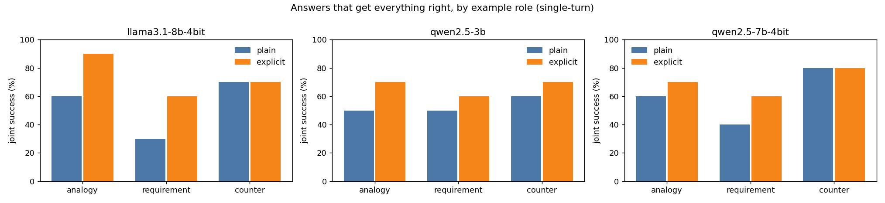
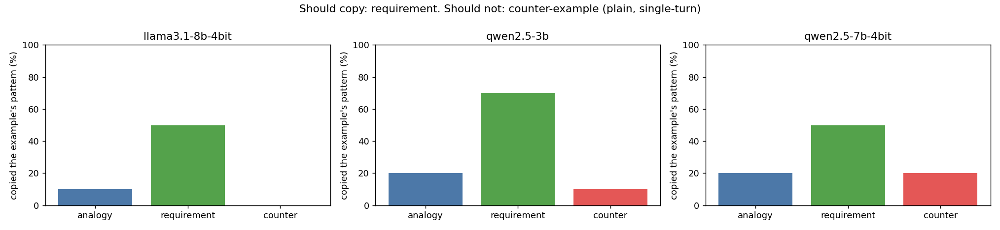

# Behaviour results (E4-E6)

Generated by `src/analyze.py`. Intervals are 95% bootstrap over seeds.

## llama3.1-8b-4bit

130 answers from 10 seeds.

| Experiment | Result | Rule | Pass? |
| --- | --- | --- | --- |
| E4 failure, plain wording | 47% [30, 67] | failure (plain) >= 25% and explicit wording halves it | no |
| E4 failure, explicit wording | 27% [13, 40] | | |
| E5 copy rate: requirement minus counter | 50% [20, 80] | copy rate (requirement) minus copy rate (counter-example) >= 15 points, CI above 0 | yes |
| E6 failure single-turn vs multi-turn | 47% vs 43% | the failure also appears in single-turn (>= 25%) | yes |

Where plain answers fail: leaked a detail 7%, missed the needed transfer 33%, broke a target rule 27%. Without any example, target rules hold in 90% of answers; with an example, 73%.

| Role | Joint success (plain) | Failure (plain) | Copied the pattern |
| --- | --- | --- | --- |
| analogy | 60% | 40% | 10% |
| requirement | 30% | 70% | 50% |
| counter | 70% | 30% | 0% |

| Role | Wording | Turns | n | Format | Rules kept | Transfer right | Leaked | Joint | Copied pattern |
| --- | --- | --- | --- | --- | --- | --- | --- | --- | --- |
| analogy | plain | single | 10 | 100% | 90% | 60% | 0% | 60% | 10% |
| analogy | plain | multi | 10 | 100% | 80% | 70% | 20% | 60% | 20% |
| analogy | explicit | single | 10 | 100% | 100% | 90% | 0% | 90% | 20% |
| analogy | explicit | multi | 10 | 100% | 90% | 80% | 10% | 80% | 20% |
| requirement | plain | single | 10 | 100% | 50% | 50% | 20% | 30% | 50% |
| requirement | plain | multi | 10 | 100% | 60% | 50% | 20% | 30% | 50% |
| requirement | explicit | single | 10 | 100% | 70% | 70% | 0% | 60% | 70% |
| requirement | explicit | multi | 10 | 100% | 70% | 60% | 0% | 50% | 60% |
| counter | plain | single | 10 | 100% | 80% | 90% | 0% | 70% | 0% |
| counter | plain | multi | 10 | 100% | 80% | 90% | 0% | 80% | 0% |
| counter | explicit | single | 10 | 100% | 80% | 80% | 0% | 70% | 0% |
| counter | explicit | multi | 10 | 100% | 80% | 80% | 0% | 70% | 0% |

## qwen2.5-3b

130 answers from 10 seeds.

| Experiment | Result | Rule | Pass? |
| --- | --- | --- | --- |
| E4 failure, plain wording | 47% [23, 70] | failure (plain) >= 25% and explicit wording halves it | no |
| E4 failure, explicit wording | 33% [13, 53] | | |
| E5 copy rate: requirement minus counter | 60% [30, 90] | copy rate (requirement) minus copy rate (counter-example) >= 15 points, CI above 0 | yes |
| E6 failure single-turn vs multi-turn | 47% vs 40% | the failure also appears in single-turn (>= 25%) | yes |

Where plain answers fail: leaked a detail 17%, missed the needed transfer 40%, broke a target rule 13%. Without any example, target rules hold in 80% of answers; with an example, 87%.

| Role | Joint success (plain) | Failure (plain) | Copied the pattern |
| --- | --- | --- | --- |
| analogy | 50% | 50% | 20% |
| requirement | 50% | 50% | 70% |
| counter | 60% | 40% | 10% |

| Role | Wording | Turns | n | Format | Rules kept | Transfer right | Leaked | Joint | Copied pattern |
| --- | --- | --- | --- | --- | --- | --- | --- | --- | --- |
| analogy | plain | single | 10 | 100% | 90% | 50% | 10% | 50% | 20% |
| analogy | plain | multi | 10 | 100% | 80% | 50% | 10% | 40% | 10% |
| analogy | explicit | single | 10 | 100% | 90% | 80% | 10% | 70% | 20% |
| analogy | explicit | multi | 10 | 100% | 70% | 70% | 10% | 50% | 20% |
| requirement | plain | single | 10 | 100% | 90% | 70% | 30% | 50% | 70% |
| requirement | plain | multi | 10 | 100% | 90% | 80% | 20% | 70% | 80% |
| requirement | explicit | single | 10 | 100% | 80% | 70% | 0% | 60% | 70% |
| requirement | explicit | multi | 10 | 100% | 70% | 90% | 30% | 50% | 90% |
| counter | plain | single | 10 | 100% | 80% | 60% | 10% | 60% | 10% |
| counter | plain | multi | 10 | 100% | 90% | 70% | 10% | 70% | 10% |
| counter | explicit | single | 10 | 100% | 80% | 80% | 0% | 70% | 0% |
| counter | explicit | multi | 10 | 100% | 80% | 80% | 20% | 70% | 10% |

## qwen2.5-7b-4bit

130 answers from 10 seeds.

| Experiment | Result | Rule | Pass? |
| --- | --- | --- | --- |
| E4 failure, plain wording | 40% [23, 57] | failure (plain) >= 25% and explicit wording halves it | no |
| E4 failure, explicit wording | 30% [13, 50] | | |
| E5 copy rate: requirement minus counter | 30% [-10, 70] | copy rate (requirement) minus copy rate (counter-example) >= 15 points, CI above 0 | no |
| E6 failure single-turn vs multi-turn | 40% vs 43% | the failure also appears in single-turn (>= 25%) | yes |

Where plain answers fail: leaked a detail 17%, missed the needed transfer 30%, broke a target rule 13%. Without any example, target rules hold in 90% of answers; with an example, 87%.

| Role | Joint success (plain) | Failure (plain) | Copied the pattern |
| --- | --- | --- | --- |
| analogy | 60% | 40% | 20% |
| requirement | 40% | 60% | 50% |
| counter | 80% | 20% | 20% |

| Role | Wording | Turns | n | Format | Rules kept | Transfer right | Leaked | Joint | Copied pattern |
| --- | --- | --- | --- | --- | --- | --- | --- | --- | --- |
| analogy | plain | single | 10 | 100% | 90% | 80% | 10% | 60% | 20% |
| analogy | plain | multi | 10 | 90% | 80% | 70% | 11% | 50% | 20% |
| analogy | explicit | single | 10 | 90% | 80% | 80% | 0% | 70% | 20% |
| analogy | explicit | multi | 10 | 100% | 80% | 90% | 10% | 60% | 20% |
| requirement | plain | single | 10 | 100% | 80% | 50% | 40% | 40% | 50% |
| requirement | plain | multi | 10 | 100% | 80% | 60% | 40% | 50% | 60% |
| requirement | explicit | single | 10 | 90% | 80% | 70% | 11% | 60% | 70% |
| requirement | explicit | multi | 10 | 100% | 90% | 90% | 0% | 80% | 100% |
| counter | plain | single | 10 | 100% | 90% | 80% | 0% | 80% | 20% |
| counter | plain | multi | 10 | 100% | 90% | 70% | 0% | 70% | 20% |
| counter | explicit | single | 10 | 100% | 90% | 80% | 0% | 80% | 0% |
| counter | explicit | multi | 10 | 100% | 100% | 90% | 0% | 90% | 0% |

